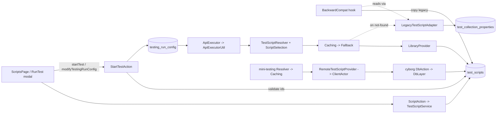

# Test script library (pre/post request scripts)

## Purpose
A library of named pre-request / post-request JavaScript scripts (Nashorn). A testing run picks one
pre and one post script; the ids live on `TestingRunConfig` (`preRequestScriptId`,
`postRequestScriptId`). Replaces the old model of one script per type per account.

Touches three repos that must stay in sync:
- `akto` (dashboard, libs, apps/testing)
- `akto-mini-2/akto` (cyborg = the database-abstractor that mini-testing calls)
- `akto-mini-services/akto` (mini-testing)

## Id semantics (Java, JSON and JS must agree)
`TestingRunConfig.preRequestScriptId` / `postRequestScriptId` (String). Interpreted ONLY by
`ScriptSelection.from(rawId, type)`; no caller re-implements the checks.

| Value | Runtime | `modifyTestingRunConfig` |
|---|---|---|
| `null` / absent | `default-test-pre` / `default-test-post` if it exists, else no script (today's behaviour: legacy configs, CI/CD, test editor, playground, ad-hoc Build/Memory configs) | unchanged |
| `""` (`TestScript.NO_SCRIPT`) | explicitly no script | set to none |
| `<id>` | that script | set, after checking it exists and its type matches |

UI sending rules (`RunTest.jsx`, `ScriptSelectDropdown.jsx`, `testing/scripts/scriptTypes.js`):
- New run: preselects the default script's real id when one exists, otherwise `""`.
- New run when the script list failed to load: sends no ids, so the run keeps the default behaviour,
  and the form says so. A load failure never turns into "no script".
- Editing a config: the stored value is shown as is (a stored `null` displays as the default script)
  and is sent back unchanged, so an untouched `null` stays `null` (= unchanged).
- A stored id no longer in the library is shown as "Unavailable script", never as "No script".

## Data flow

## Design (patterns and why)
- `TestScriptProvider` interface: `findById(id)`, `findDefault(type)`. One read contract for all runtimes.
- `LegacyTestScriptAdapter` (Adapter): the only caller of `TestCollectionPropertiesDao.findLegacyTestScript`
  (the legacy one-doc-per-type store, decoded via `withDocumentClass(TestScript.class)`); maps it to a
  library-shaped `TestScript` named `default-test-{type}`. The migration reads through it too. There is
  deliberately no second DAO over `test_collection_properties`: one DAO per collection.
- `FallbackTestScriptProvider` (Chain): falls through ONLY on not-found. Exceptions propagate, so an
  outage never silently serves legacy data.
- `CachingTestScriptProvider` (Decorator): bounded (10k) + TTL (5 min); caches hits and truly-absent
  results; never caches exceptions.
- `ScriptSelection` (value object): DEFAULT / NONE / BY_ID. Pure data in libs/dao; the dispatch on
  the kind lives in `TestScriptResolver` (libs/dao cannot depend on the providers in libs/utils).
- `TestScriptProviders` (Factory): per-runtime wiring. Main: Caching(Fallback(Library, Legacy)).
  Cyborg: Fallback(Library, Legacy). Mini-testing: Caching(Remote).
- `TestScriptService` + `TestScriptValidator` (pure) + `TestScriptException` (checked, user-facing
  message -> 422 action error): shared by `ScriptAction` and `StartTestAction`.
- `TestScriptSummary`: list response DTO; never carries the script body.
- Nashorn execution in `ApiExecutorUtil` is deliberately unchanged; only the source of the script changed.

## Decision log (status as of the feature review)
| Decision | Status | Where |
|---|---|---|
| Own collection `test_scripts`: unique `name`, indexes on `type`, `lastUpdatedAt`; legacy collection is shared with `TestCollectionPropertiesDao` | verified | `TestScriptsDao.createIndicesIfAbsent`, `DaoInit.createIndices` |
| Legacy store read only through `LegacyTestScriptAdapter` -> `TestCollectionPropertiesDao.findLegacyTestScript` (all 3 repos) | verified | grep: single caller per repo |
| null = default, "" = none, id = that script; interpreted only by `ScriptSelection` | verified | `ScriptSelection`, `TestScriptResolver`, `TestScriptService.validateRunSelection` |
| Missing / wrong-type chosen id at runtime: no script + error log | verified | `TestScriptResolver` BY_ID branch |
| Cache: max 10k, TTL 5 min, per account, never caches exceptions | verified | `CachingTestScriptProvider`; mini-testing keys by `Context.getActualAccountId` |
| Remote failures throw (were swallowed as "no script") | verified | mini-testing `ClientActor.requestTestScript` |
| Cyborg: `api/fetchTestScriptById`; old `api/fetchTestScript(type)` serves `default-test-{type}` | verified | cyborg `DbAction`, `DbLayer` |
| Migration: copies legacy keeping `_id`, skips existing name, never touches legacy, flag only on success; plus a lazy retry from `fetchAllScripts` | verified | `BackwardCompatibilityUtils.migrateTestScriptsToLibrary`, `InitializerListener.safeMigrateTestScriptsToLibrary` / `ensureTestScriptsMigrated` |
| Delete refused if referenced or `default-test-*` | verified | `TestScriptService.delete` |
| Ids validated before any write in startTest / modify; modify null = unchanged | verified | `StartTestAction.validateScriptSelections` |
| `useTestingRunConfig=false` copies both ids | verified | main `ApiExecutor.sendRequest` overload |
| Names immutable; name 1-64 chars, safe charset; javascript <= 256 KB | verified | `TestScriptValidator` |
| Prod index `(apiCollectionId,name)` on `test_collection_properties`; size of `testing_run_config` for the new index build | unverified | needs a read-only prod check |

## APIs (struts.xml, feature TEST_SCRIPTS)
| Route | Access | Input | Output |
|---|---|---|---|
| `api/fetchAllScripts` | READ | - | `scripts: TestScriptSummary[]` (max 1000, newest first) |
| `api/fetchScript` | READ | `scriptId` | `testScript` (with body) |
| `api/addScript` | READ_WRITE + usage `TEST_PRE_SCRIPT` | `name`, `scriptType`, `javascript` | `testScript` |
| `api/updateScript` | READ_WRITE + usage | `scriptId`, `javascript` | `testScript` |
| `api/deleteScript` | READ_WRITE + usage, `@Audit` `TEST_SCRIPT` | `scriptId` | - |
| `api/startTest`, `api/modifyTestingRunConfig` | existing | `preRequestScriptId`, `postRequestScriptId` (modify: inside `editableTestingRunConfig`) | validated before any write |

## Gotchas
- `ApiExecutor.sendRequest(..., useTestingRunConfig=false)` builds a fresh config and copies only
  advanced settings; it MUST also copy both script ids or chosen scripts fall back to the default.
- `TestingRunConfig.rebaseOn` must carry both ids (main and mini-testing `Main.java` rebase).
- Cyborg serialises the config from getters: new fields need getters in its DTO.
- `MCollection.updateOne` upserts; script updates use `updateOneNoUpsert` so an unknown id is a 404-style
  error, never a new document.
- Delete has a check-then-act window: a config could select the script between the reference check and
  the delete. Accepted (runtime then logs "not found" and runs no script for that config).
- Name uniqueness is case-sensitive (`Sign` and `sign` can coexist).
- Script edits reach the testing module within the 5-minute cache TTL; no cross-process invalidation.
- `SampleData` skips reload when two scripts have identical JS: key the editor by script id.
- The SSE path applies the post script twice (pre-existing; not changed here).
- Deploy order: cyborg, then dashboard, then mini-testing. Mini-testing calling `fetchTestScriptById`
  on an old cyborg gets a 404 -> exception -> request runs without the script (logged, not cached).
- Old mini-testing builds against the new cyborg (dashboard and cyborg are upgraded everywhere first;
  mini-testing rolls out per customer):

  | Mini-testing build | Calls | Gets |
  |---|---|---|
  | current | `fetchTestScriptById` / typed `fetchTestScript` | the run's chosen script |
  | 2026-03-15 to before the library (`81fcf26d7b`+) | typed `fetchTestScript` (POST) | `default-test-{type}` (legacy until migrated) |
  | before 2026-03-15 | untyped `fetchTestScript` (GET) | `default-test-pre`, run as its pre-request script (`TestScript.typeForUntypedRequest`) |

  Old builds ignore per-run choices: a run that picked another script or "No script" still runs the
  default scripts on an old mini-testing. The request carries no run context, so cyborg cannot fix
  this; the module has to be upgraded. Edits to `default-test-*` reach old builds within their cache TTL.
- Mini-testing script fetches use `sendRequestBackOff` (1+2+5 s). Kept deliberately: a blip that
  ended in "no script" would run that request unsigned (possible false negative); during a cyborg
  outage each uncached lookup waits up to ~8 s instead.
- A read failure anywhere in the chain runs that request without its script (logged). That matches
  how script errors were already handled in `ApiExecutorUtil`; failing the request instead is open work.
- `Build`/`Memory`/playground (mini-testing and main) build ad-hoc configs with null ids, i.e. default
  scripts, exactly as before. They are not inside a testing run with a chosen script.
- libs/utils (main and mini-testing) runs tests on the JUnit Platform and its vintage engine cannot
  parse junit 4.13.1, so JUnit 4 tests there are silently skipped. Script tests in libs/utils are
  JUnit 5 (`org.junit.jupiter.api`). libs/dao and apps/dashboard tests are JUnit 4.
- Cyborg's own (unused) `DbActor.fetchTestScript()` passes a null type and now gets null.
- The lazy migration retry runs at most once per account per dashboard process (unbounded-by-design
  set of account ids, same as `ensureTeamRoleAndGuardrailTagsMigrated`).

## Files
- Backend (main): `service/scripts/*`, `action/testing/ScriptAction`, `StartTestAction`,
  `libs/utils/.../testing/scripts/*`, `ApiExecutor(Util)`, `TestScriptsDao`, `TestingRunConfigDao`,
  `TestCollectionPropertiesDao.findLegacyTestScript`, `BackwardCompatibilityUtils`, `InitializerListener`.
- Frontend: `pages/testing/scripts/{ScriptsPage,ScriptEditor,ScriptSelectDropdown}.jsx`,
  `scriptTypes.js`, `RunTest.jsx`, `RunTestConfiguration.jsx`, `testing/api.js`, `observe/api.js`
  (`scriptSelection` arg), `testing/transform.js`, `LeftNav.js`, `App.js`, `permissions.js`.
- Cyborg: DTO/DAO ports, `testing/scripts/*` (no cache, no resolver), `DbLayer`, `DbAction`, struts.
- Mini-testing: DTO/DAO ports, `testing/scripts/*` + `RemoteTestScriptProvider`, `DataActor` chain,
  `ApiExecutorUtil`, local db-abstractor route.
- Tests: `ScriptSelectionTest`, `TestingRunConfigScriptIdsTest`, `TestScriptsDaoTest` (libs/dao);
  `*TestScriptProviderTest`, `TestScriptResolverTest` (libs/utils); `TestScriptValidatorTest`,
  `TestScriptServiceTest`, `ScriptActionTest`, `TestStartTestAction`, `TestScriptsLibraryMigrationTest`
  (dashboard); `ApiExecutorUtilScriptSelectionTest` (mini-testing).

## Open work
- Migrated scripts carry no explicit source marker (only the `default-test-*` name and the legacy
  author/timestamps distinguish them).
- Remove the legacy fallback (`LegacyTestScriptAdapter`, `TestCollectionPropertiesDao.findLegacyTestScript`) once all accounts are migrated.
- `Resource.TEST_SCRIPT` was added to the audit enum; sibling repos that decode audit logs with an older enum would not know it (none found that read them).
- The SaaS gate in script writes uses hardcoded whitelisted account ids (pre-existing, not expanded).
- Unverified: whether prod accounts carry the unique `(apiCollectionId,name)` index on `test_collection_properties`.
