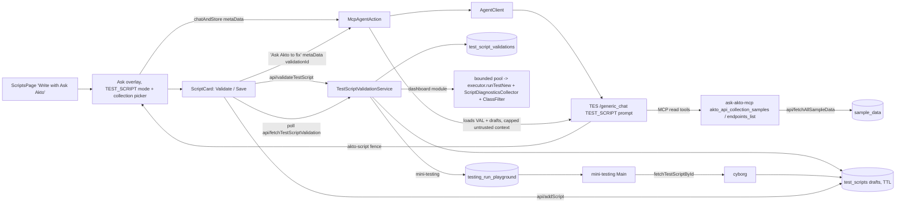

# Ask Akto script writer (write, validate, fix, save)

Status: in progress. Each row in the decision log is marked `planned`, `unverified` or `verified`. Update a row in the
same change that builds or proves it.

## Purpose
Ask Akto writes pre/post-request scripts (the library in `../CLAUDE.md`) for an API collection.

1. The user picks a collection, or names it in the prompt.
2. The agent reads samples of the collection's APIs, works out how they chain (POST then GET poll, chunk polling, SSE),
   and replies with a script.
3. The user clicks **Validate** and picks an endpoint, a testing module (Default (dashboard) or a mini-testing name) and
   a test role. The dashboard replays that endpoint with the script.
4. **Ask Akto to fix** sends the stored result back into the same conversation: script errors, logs, and request and
   response before and after each script.
5. **Save to library** stores the final script through the existing `api/addScript`.

The agent never sends traffic itself. Every replay is a user click.

Repos involved:
- `akto`: dashboard, libs/dao, libs/utils and the frontend.
- `test-editor-services` (TES, the chat agent): `ConversationType.TEST_SCRIPT` and `skills/test-scripts/SKILL.md`.
- `clone-test/test-editor-services` (ask-akto-mcp, the MCP tools server): the `akto_api_collection_samples` tool.
- No cyborg or mini-testing change: mini-testing already fetches scripts by id through cyborg `fetchTestScriptById`.

## Data flow


| Hop | File | Timeout | On failure | Idempotency |
|---|---|---|---|---|
| Overlay → chatAndStore | `useAskChat.js`, `McpAgentAction.java` | AgentClient 600s | Error turn in chat | Per turn insert (existing) |
| TES → MCP tools | `anthropicAgentService.ts`, `inventory.ts` | AktoClient 120s | `status: unavailable` to agent | Read only |
| validateTestScript | `TestScriptValidationService` | returns immediately | 422 with reason | `_id = validationId` |
| Dashboard job | pool + `executor.runTestNew` | 11 min cap, then cancel | FAILED/TIMED_OUT + diagnostics | draft ids derived from validationId |
| Mini-testing job | `TestingRunPlayground` | 5 min pickup, 11 min total | TIMED_OUT "not picked up" | playground hexId stored on the validation |
| fetchTestScriptValidation | same service | sync, projected | not-found error if unknown | read |
| Feedback turn | `TestScriptValidationContextBuilder` | — | "unavailable" sections | read |

Timeouts nest: UI poll (12 min) > job cap (11 min) > the longest script wait (10 min, `MAX_WAIT_MS_CHUNKS` in the example
post script).

## Decision log
| Decision | Choice and why | Status |
|---|---|---|
| How an unsaved script reaches the runtime | A **draft** `TestScript` per validation, `ai-draft-<validationId>-pre/post`, referenced by id. Each attempt gets a new id, so the 5-min script caches never serve a stale body. Inline JS on `TestingRunConfig` would need a DTO port in 3 repos. | planned |
| How drafts are told apart | The `ai-draft-` name prefix (reserved in `TestScriptValidator`), plus `expireAt` set only on drafts (TTL 24h). `findAllSummaries` hides drafts; `validateRunSelection` rejects them. | planned |
| Cyborg decoding a `test_scripts` doc that has `expireAt` | Assumes the POJO codec skips unknown fields. **Blocker if false**: script fetches on mini-testing would break. | unverified |
| Replay vehicle | A backend-constant replay test template run through the playground machinery in both modules: the only path where mini-testing honours script ids and the test role. Whether the engine accepts an empty `req` list is still to be proven. | unverified |
| Sync or job | A job. Scripts sleep and poll for up to 10 min. Dashboard: dedicated bounded pool (4 threads, queue 20, max 2 running per account), 11-min cap then `cancel(true)`. Mini-testing: playground hexId, completed on read. | planned |
| Idempotency | The client generates `validationId`, used as the `_id`; a retry returns the existing doc and never replays twice. | planned |
| Diagnostics | Dashboard module only. A ThreadLocal `ScriptDiagnosticsCollector` in libs/utils, active only during a validation. It records the exception, `print` output (capped 16 KB) and request/body before and after each script (32 KB each). Mini-testing results carry `available=false` plus a reason, never "no errors". | planned |
| Sandbox | Drafts only: the Nashorn engine is built with a `ClassFilter` allowlist. `java.lang.System` exposes `getenv`, so time and sleep may need `akto.*` bindings instead. Library scripts are unchanged. Drafts on mini-testing run unsandboxed on the customer's infra (accepted risk). | planned |
| What the agent receives back | McpAgentAction loads the validation and the draft bodies by `validationId` and builds a capped `contextString` wrapped as untrusted. TES now sends `contextString` on every turn that has one. | planned |
| Samples at collection scale | New MCP tool `akto_api_collection_samples`: newest sample per endpoint, at most 10 endpoints a page, 20k-char budget, `unavailable` vs `empty`, reusing the compaction in `endpoint-samples.ts`. | planned |
| Agent mode | `ConversationType.TEST_SCRIPT` (Java and TS), its own prompt (takes priority over the context-source prompt), read-only tools, and per-type model, maxTokens and budget from env. Default turn limits (4000 tokens, $0.20, Haiku) cannot fit a script of about 7k tokens. | planned |
| Output contract | A ```` ```akto-script ```` fence whose first line is `// @akto-script type=<PRE_REQUEST/POST_REQUEST> collection=<id> name=<suggested>`. The card renders only once streaming has finished. Any collection id in the header is re-checked by `collectionInterceptor` on Validate. | planned |
| Authz | Both routes carry the TEST_SCRIPTS feature and the TEST_PRE_SCRIPT usage check, `TestScriptService.requireWriteAccess` and `collectionInterceptor`. The test role must be visible to the user, and the mini-testing name must be active with hybrid testing on. | planned |

## Gotchas
- **POST bindings differ by module.**
  - Main: response headers are `responseHeaders` and request headers are `headers`.
  - Mini-testing: response headers are `headers` and request headers are `requestHeaders`, plus `streamingResponse` and `conversationState`.
  - The skill tells the agent to probe both. A script validated on one module can still misbehave on the other.
- The test role is applied only when the API is in the role's endpoint logical group (`Executor.modifyRawApiUsingTestRole`).
  The validation shows a warning in that case.
- Mini-testing scans only playgrounds created in the last 5 min. Cyborg's playground fetch has no name filter, so a job
  scheduled for another instance can hold up the queue (pre-existing).
- Drafts live in `test_scripts` but are hidden. Never select one in a testing run.
- `contextString` is sent on every turn that has one (it used to be first turn only).
- TES `npm test` (`ts-node tests/*.ts`) may only run the first file. Run test files one at a time.
- `service/scripts/pre-script.js` and `post-script.js` are local, untracked examples containing a customer's hosts and
  ids. Never commit them. The skill uses sanitized versions of their patterns.

## Open work
- Port diagnostics and the draft allowlist to mini-testing (cyborg + mini-testing, cherry-picked).
- A cluster-wide limit on concurrent validations (today's limit is per JVM).
- If an agent-initiated replay tool is ever wanted, it needs a server-issued confirmation token for each replay.
