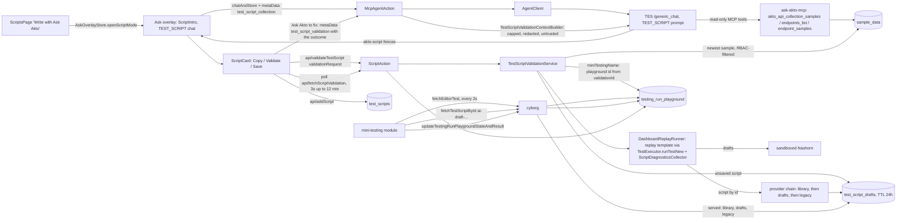

# Ask Akto script writer (write, validate, fix, save)

## Purpose
Ask Akto writes pre/post-request scripts (the library in `../CLAUDE.md`) for an API collection.

1. The user picks a collection, or names it in the prompt.
2. The agent reads samples of the collection's APIs, works out how they chain (POST then GET poll, chunk polling, SSE),
   and replies with a script.
3. The user clicks **Validate** and picks an endpoint, an optional test role and the module to run on. The newest
   captured request of that endpoint is replayed with the script, either **inline in the dashboard module** (the way
   the test editor's Run test does) or **in a mini-testing module** (the way its Run test does).
4. **Ask Akto to fix** sends the result back into the same conversation: script errors, logs, and request and response
   before and after each script.
5. **Save to library** stores the final script through the existing `api/addScript`.

The agent never sends traffic itself. Every replay is a user click.

| Repo | What changed |
|---|---|
| `akto` | libs/dao, libs/utils, dashboard service and action, frontend |
| `test-editor-services` (TES, the chat agent) | `ConversationType.TEST_SCRIPT`, `skills/test-scripts/SKILL.md`, `src/utils/testScriptMode.ts` |
| `clone-test/test-editor-services` (ask-akto-mcp, the MCP tools server) | the `akto_api_collection_samples` tool |

Validation runs in the dashboard module (inline, with script errors and logs) or in a mini-testing module (scheduled
and polled, outcome only until the module's build is upgraded). See "Mini-testing".

## Data flow


| Hop | File | Timeout | On failure | Idempotency |
|---|---|---|---|---|
| Overlay → chatAndStore | `useAskChat.js`, `McpAgentAction.java` | AgentClient 600s | Error turn in chat | Per-turn insert (existing) |
| TES → MCP tools | `anthropicAgentService.ts`, `collection-samples.ts` | AktoClient 120s | Per endpoint `status: unavailable`; all endpoints failing → tool error | Read only |
| validateTestScript | `ScriptAction.validateTestScript` → `TestScriptValidationService.validate` | Frontend call 11 min (default is 60s); no server-side cap, same as the test editor | 422 with the reason: bad input, no sample (including a collection outside the user's RBAC), replay threw, engine never sent the request | Draft ids derive from the client's `validationId`; `insertIfAbsent` |
| Replay | `DashboardReplayRunner` | Bounded by the scripts' own waits and HTTP timeouts (the skill caps waits at 10 min) | Exceptions → 422 "The replay failed: …" | No writes besides the draft |
| Schedule in a module | `ScriptAction.validateTestScript` → `TestScriptValidationService.startInMiniTesting` | Returns at once | 422: hybrid testing off, module has no heartbeat in 20 min, no sample, bad input. Nothing is written for these (the module check runs before any draft is saved) | Playground `_id` derives from `validationId`; a duplicate key means "already scheduled" |
| Module run | mini-testing `Main.checkForPlaygroundTest` (own repo) | Picks up playgrounds from the last 5 min, every 2s | A module only reports when the run ends, so SCHEDULED means waiting or running, never failed | Module writes by id |
| Read the result | `api/fetchScriptValidation` → `TestScriptValidationService.fetchMiniTestingOutcome` | Frontend polls every 3s for 12 min, then "No result yet" with Check again (not a failure) | 422: unknown id, not a validation playground, collection outside the user's access, finished without a result, engine did not send the request | Read only |
| Feedback turn | `McpAgentAction` (`test_script_validation` case) → `TestScriptValidationContextBuilder` | — | Missing pieces stated as "unavailable" | Read |

## Decision log
| Decision | Choice and why | Status |
|---|---|---|
| Where unsaved scripts live | `TestScriptDraft extends TestScript` (adds `expireAt`) in its own collection `test_script_drafts`, where every document is under a TTL index (24h). `test_scripts` is untouched. Draft ids are `ai-draft-<validationId>-pre/post`. | verified (`TestScriptDraftsDaoTest`) |
| How the runtime finds a draft | `TestScriptProviders`: Library → `DraftTestScriptProvider` (only queries for `ai-draft-` ids) → Legacy. A draft is never a library script: `startTest` and `requireLibraryScript` read only `test_scripts`. | verified (`DashboardReplayRunnerTest.draftScriptsRunThroughTheEngineWithDiagnostics`, service test) |
| Sandbox | Drafts only, picked by **id prefix** (`TestScriptDraft.isDraftId`), not class type, so it still works after a JSON round trip. `ScriptEngines.create(true)` builds Nashorn with a `ClassFilter` allowlist (loaded reflectively; the Java 17 dashboard uses runtime-scoped standalone Nashorn). It never falls back to the plain engine. | verified (`ScriptEnginesTest`, E2E test) |
| How the replay runs | Inline, like the test editor (your choice). A backend-constant template (`ScriptValidationReplayTemplate`: empty `req`, accept any response) through `TestExecutor.runTestNew`, using the `RawApi` overload so the static `TestingConfigurations` raw-API cache is never read. The engine needs the account's `ATTACKER_TOKEN_ALL` role; without it the validation is a 422 with the engine's reason. Nothing is persisted: `generateTestingRunResultAndIssue` is not called, and it only builds in-memory objects anyway. | verified (`DashboardReplayRunnerTest`) |
| Diagnostics | A ThreadLocal `ScriptDiagnosticsCollector` (libs/utils), active only inside `DashboardReplayRunner`. Per phase it records runs, the exception `ApiExecutorUtil` otherwise swallows, `print` output (16 KB), and request/response before and after (32 KB). The result is returned as the shared `ScriptDiagnostics {pre, post}` DTO (libs/dao). | verified |
| Access | The same gates as the script library: route `roleAccessInterceptor` TEST_SCRIPTS READ_WRITE plus `usageInterceptor` TEST_PRE_SCRIPT, and `TestScriptService.requireWriteAccess` (SaaS gate). Collection RBAC is enforced by `SampleDataDao` (`AccountsContextDaoWithRbac`): an endpoint outside the user's collections has no sample to replay. The mini-testing read checks collection access itself (`UsersCollectionsList`), because a playground is not an RBAC-filtered collection. | verified (`ScriptActionTest`; `onlyValidationPlaygroundsOnReachableEndpointsAreReadable`) |
| Request shape | One DTO, `ScriptValidationRequest`, bound from the JSON body `{validationRequest: {...}}`, the same nested binding as `StartTestAction.editableTestingRunConfig`. Response: `scriptValidationResult` (`ReplayOutcome`). | verified |
| What the agent receives back | The frontend sends the outcome it got plus the script bodies as metaData. It is the user's own result going to the user's own conversation. `McpAgentAction` maps it to `ScriptValidationFeedback` (Jackson), and `TestScriptValidationContextBuilder` caps every section, redacts `authorization`/`cookie`/`set-cookie` values (the same three the samples tools redact), and fences replay content as untrusted. TES uses `contextString` on every TEST_SCRIPT turn. | verified (`TestScriptValidationContextBuilderTest`) |
| Role warning | If the chosen role's logical group does not cover the endpoint, the outcome says the captured auth was used. The engine skips the role silently there (`Executor.modifyRawApiUsingTestRole`). | verified |
| Collection samples tool | `akto_api_collection_samples`: newest sample per endpoint, at most 10 endpoints a page, `ok`/`empty`/`unavailable` per endpoint, 20k-char budget, reusing the `endpoint-samples.ts` compaction. | verified (`collection-samples.tool.test.ts`) |
| Agent mode | `ConversationType.TEST_SCRIPT` (Java and TS) with its own prompt; ignores contextSource; read tools only (`isTestScriptTool`); one gate, `isToolAllowed`, for Claude and Vertex. Sonnet, 16k tokens, $1.00 budget placeholder; env-overridable. | verified (TES test); budget value unverified |
| Output contract | ```` ```akto-script ```` fences with a `// @akto-script type=… collection=… name=…` header. Parsed out of the reply (`scriptBlocks.js`) after streaming finishes, so half-written scripts never become cards. | verified (scratch parser check) |

## Mini-testing
A mini-testing name on the request schedules the replay as a test-editor playground instead of running it inline.
`TestScriptValidationService.startInMiniTesting` checks that hybrid testing is on and that the module sent a heartbeat in
the last 20 minutes (`MiniTestingModules`, the rule the test editor's module picker uses), saves the drafts, and inserts a
`TestingRunPlayground` holding `ScriptValidationReplayTemplate.YAML`, the newest sample, and a run config with the draft ids
and the role. Its `_id` is a hash of `validationId`, so a retried click schedules nothing new.

**Shipped (cyborg and dashboard only; works with any mini-testing build):**
- Cyborg's `DbLayer.fetchTestScriptById` serves from `TestScriptProviders.served()`: library, then drafts, then legacy.
  Mini-testing already fetches scripts by id, so it runs a draft without a code change.
- The outcome is built from the result mini-testing already writes back: `ReplayOutcome.from(result, null, reason)`
  marks diagnostics unavailable.

**What an older mini-testing build cannot do (accepted):**
- It runs the draft **without the sandbox**. A draft is written by an LLM from captured traffic, so a hostile sample can
  steer it, and on that machine a script can read the module's environment. The Validate modal warns before the run.
- It reports no script errors or logs (its engine swallows them), so a script that threw looks like one that never ran.
  The outcome says "unavailable" and the user compares the replay with the original request.
- With `TEST_PRE_SCRIPT` not granted on the module's account, no script runs and nothing says so.

**Next (a mini-testing release):**
1. Cherry-pick the libs/utils commit (`ScriptEngines`, `ScriptDiagnosticsCollector`, the `ApiExecutorUtil` hooks) into
   mini-testing and resolve its own `ApiExecutorUtil`, whose bindings differ. The sandbox is picked by the `ai-draft-` id
   prefix, so it needs no flag.
2. Add `ScriptDiagnostics scriptDiagnostics` to `TestingRunPlayground`. `handleTestEditorPlayground` wraps its run in
   `ScriptDiagnosticsCollector.begin/end`, and cyborg saves it with the result (one more `$set`).
3. `fetchMiniTestingOutcome` passes the saved diagnostics to `ReplayOutcome.from`. The frontend needs no change.

Deploy order: cyborg, dashboard, mini-testing. An older cyborg ignores the new field, so the outcome stays "unavailable".

## Gotchas
- **POST bindings differ by module.**
  - Main: response headers are `responseHeaders` and request headers are `headers`.
  - Mini-testing: response headers are `headers` and request headers are `requestHeaders`, plus `streamingResponse` and `conversationState`.
  - The skill tells the agent to probe both.
- **The sandbox does not close `java.net.URL`.** A draft can still open `file:` URLs and reach internal hosts from the
  dashboard JVM. The SaaS script-write gate and the feature label are the control.
- **Inline runs hold the HTTP request.** The frontend waits up to 11 minutes; an ingress/LB timeout shorter than the
  script's waits shows an error while the replay finishes server-side (unverified which limit applies per deployment).
- `SampleDataDao` applies collection RBAC on `findOne` using `Context.userId`. Tests must stub
  `UsersCollectionsList.getCollectionsIdForUser`, or a leftover user context makes the sample "missing".
- Scripts run only when `UsageMetricUtils.getFeatureAccessSaas(account, "TEST_PRE_SCRIPT")` grants it (needs a metered
  org). The E2E test stubs it with `mockStatic`, which is thread-local, which also proves the scripts run on the
  collector's thread.
- **A mini-testing module may replay the first sample it saw for an endpoint.** Its engine reads a static per-endpoint
  cache (`TestingConfigurations`) that is not cleared between playgrounds; the dashboard path bypasses it. The outcome
  says so.
- **Mini-testing picks up one playground at a time.** Cyborg's `fetchEditorTest` returns one scheduled playground of any
  module, and a module skips one named for another, so another module's pending playground can delay this one
  (pre-existing). A module also runs playgrounds on the thread it shares with its periodic jobs, so a polling script
  holds that thread for the whole run.
- **Validation playgrounds are not deleted.** `testing_run_playground` has a TTL index on `createdAt`, an int, and
  MongoDB TTL indexes only expire dates (unverified: from MongoDB's TTL rules, not tested here).
- Copilot (`copilotAgentService`) approves every tool, so TEST_SCRIPT's read-only gate does not apply there (pre-existing).
- TES `npm test` only runs the first file, so run test files one at a time.
- Pre-existing failures: 9 order-dependent dashboard tests in `service/collections`, failing on HEAD too.

## Files
- libs/dao:
  - `TestScriptDraft`, `TestScriptDraftsDao` (TTL), `ScriptDiagnostics`, `ScriptPhaseDiagnostics`
  - `GenericAgentConversation.TEST_SCRIPT`
  - `DaoInit`
- libs/utils:
  - `testing/scripts/DraftTestScriptProvider`, `ScriptEngines`, `ScriptDiagnosticsCollector`
  - `TestScriptProviders`, `ApiExecutorUtil`
- dashboard:
  - `service/scripts/validation/*`: request DTO, input validator, service, runner, outcome, feedback DTO, context builder, template
  - `ScriptAction.validateTestScript`, `fetchScriptValidation` and their `struts.xml` routes
  - `utils/MiniTestingModules` (also used by `StartTestAction.fetchMiniTestingServiceNames`)
  - `McpAgentAction` (the `test_script_collection` and `test_script_validation` metaData cases)
  - `TestScriptService.requireLibraryScript`
- frontend:
  - `pages/dashboard/ask/askOverlayStore.js`, `AskOverlay`, `AskOverlayButton`
  - `chat/useAskChat`, `ChatView`, `ChatMessage`
  - `pages/dashboard/ask/script/*`: `ScriptIntro`, `ScriptCard`, `ValidateScriptModal`, `ValidationResultView`,
    `SaveScriptModal`, `ScriptTypePicker`, `scriptBlocks`, `collectionOptions`, `useMiniTestingModules`,
    `useValidationPolling`
  - `testing/api.js`, `testing/scripts/ScriptsPage.jsx`
- cyborg (own repo, branch `feature/cyborg-release`): `DbLayer.fetchTestScriptById`, `TestScriptProviders.served`,
  `DraftTestScriptProvider` (copied unchanged from master), the libs/dao drafts files.
- Tests:
  - libs/dao: `TestScriptDraftsDaoTest`
  - libs/utils: `ScriptEnginesTest`, `ScriptDiagnosticsCollectorTest`
  - dashboard: `TestScriptValidationServiceTest`, `DashboardReplayRunnerTest`, `TestScriptValidationContextBuilderTest`,
    `ScriptActionTest`
  - cyborg: `ServedTestScriptProviderTest` (libs/utils)
  - TES: `tests/testScriptMode.test.ts`
  - ask-akto-mcp: `src/tools/collection-samples.tool.test.ts`

## Open work
- The mini-testing release above (sandbox and error capture for modules).
- Browser end-to-end, and a run against a real mini-testing module through a real cyborg; set `TEST_SCRIPT_MAX_BUDGET_USD` from current pricing.
- An agent-initiated replay tool would need a server-issued confirmation token per replay.
