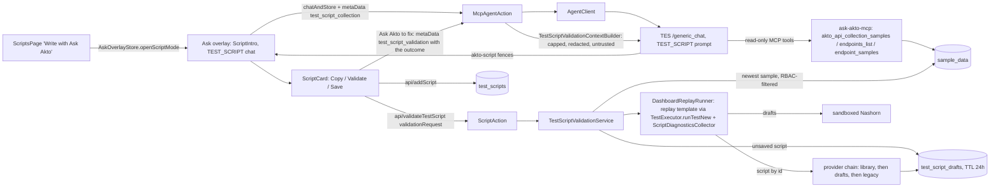

# Ask Akto script writer (write, validate, fix, save)

## Purpose
Ask Akto writes pre/post-request scripts (the library in `../CLAUDE.md`) for an API collection.

1. The user picks a collection, or names it in the prompt.
2. The agent reads samples of the collection's APIs, works out how they chain (POST then GET poll, chunk polling, SSE),
   and replies with a script.
3. The user clicks **Validate** and picks an endpoint and an optional test role. The dashboard replays that endpoint's
   newest captured request with the script. It runs **inline in the dashboard module**, the way the test editor's
   Run test does.
4. **Ask Akto to fix** sends the result back into the same conversation: script errors, logs, and request and response
   before and after each script.
5. **Save to library** stores the final script through the existing `api/addScript`.

The agent never sends traffic itself. Every replay is a user click.

| Repo | What changed |
|---|---|
| `akto` | libs/dao, libs/utils, dashboard service and action, frontend |
| `test-editor-services` (TES, the chat agent) | `ConversationType.TEST_SCRIPT`, `skills/test-scripts/SKILL.md`, `src/utils/testScriptMode.ts` |
| `clone-test/test-editor-services` (ask-akto-mcp, the MCP tools server) | the `akto_api_collection_samples` tool |

Today validation runs in the dashboard module only (a mini-testing name is rejected). The mini-testing extension is in
"Next: mini-testing".

## Data flow


| Hop | File | Timeout | On failure | Idempotency |
|---|---|---|---|---|
| Overlay → chatAndStore | `useAskChat.js`, `McpAgentAction.java` | AgentClient 600s | Error turn in chat | Per-turn insert (existing) |
| TES → MCP tools | `anthropicAgentService.ts`, `collection-samples.ts` | AktoClient 120s | Per endpoint `status: unavailable`; all endpoints failing → tool error | Read only |
| validateTestScript | `ScriptAction.validateTestScript` → `TestScriptValidationService.validate` | Frontend call 11 min (default is 60s); no server-side cap, same as the test editor | 422 with the reason: bad input, no sample (including a collection outside the user's RBAC), replay threw, engine never sent the request | Draft ids derive from the client's `validationId`; `insertIfAbsent` |
| Replay | `DashboardReplayRunner` | Bounded by the scripts' own waits and HTTP timeouts (the skill caps waits at 10 min) | Exceptions → 422 "The replay failed: …" | No writes besides the draft |
| Feedback turn | `McpAgentAction` (`test_script_validation` case) → `TestScriptValidationContextBuilder` | — | Missing pieces stated as "unavailable" | Read |

## Decision log
| Decision | Choice and why | Status |
|---|---|---|
| Where unsaved scripts live | `TestScriptDraft extends TestScript` (adds `expireAt`) in its own collection `test_script_drafts`, where every document is under a TTL index (24h). `test_scripts` is untouched. Draft ids are `ai-draft-<validationId>-pre/post`. | verified (`TestScriptDraftsDaoTest`) |
| How the runtime finds a draft | `TestScriptProviders`: Library → `DraftTestScriptProvider` (only queries for `ai-draft-` ids) → Legacy. A draft is never a library script: `startTest` and `requireLibraryScript` read only `test_scripts`. | verified (`DashboardReplayRunnerTest.draftScriptsRunThroughTheEngineWithDiagnostics`, service test) |
| Sandbox | Drafts only, picked by **id prefix** (`TestScriptDraft.isDraftId`), not class type, so it still works after a JSON round trip. `ScriptEngines.create(true)` builds Nashorn with a `ClassFilter` allowlist (loaded reflectively; the Java 17 dashboard uses runtime-scoped standalone Nashorn). It never falls back to the plain engine. | verified (`ScriptEnginesTest`, E2E test) |
| How the replay runs | Inline, like the test editor (your choice). A backend-constant template (`ScriptValidationReplayTemplate`: empty `req`, accept any response) through `TestExecutor.runTestNew`, using the `RawApi` overload so the static `TestingConfigurations` raw-API cache is never read. The engine needs the account's `ATTACKER_TOKEN_ALL` role; without it the validation is a 422 with the engine's reason. Nothing is persisted: `generateTestingRunResultAndIssue` is not called, and it only builds in-memory objects anyway. | verified (`DashboardReplayRunnerTest`) |
| Diagnostics | A ThreadLocal `ScriptDiagnosticsCollector` (libs/utils), active only inside `DashboardReplayRunner`. Per phase it records runs, the exception `ApiExecutorUtil` otherwise swallows, `print` output (16 KB), and request/response before and after (32 KB). The result is returned as the shared `ScriptDiagnostics {pre, post}` DTO (libs/dao). | verified |
| Access | The same gates as the script library: route `roleAccessInterceptor` TEST_SCRIPTS READ_WRITE plus `usageInterceptor` TEST_PRE_SCRIPT, and `TestScriptService.requireWriteAccess` (SaaS gate). Collection RBAC is enforced by `SampleDataDao` (`AccountsContextDaoWithRbac`): an endpoint outside the user's collections has no sample to replay. No other checks. | verified (`ScriptActionTest`, `aCollectionOutsideTheUsersRbacHasNoSampleToReplay`) |
| Request shape | One DTO, `ScriptValidationRequest`, bound from the JSON body `{validationRequest: {...}}`, the same nested binding as `StartTestAction.editableTestingRunConfig`. Response: `scriptValidationResult` (`ReplayOutcome`). | verified |
| What the agent receives back | The frontend sends the outcome it got plus the script bodies as metaData. It is the user's own result going to the user's own conversation. `McpAgentAction` maps it to `ScriptValidationFeedback` (Jackson), and `TestScriptValidationContextBuilder` caps every section, redacts `authorization`/`cookie`/`set-cookie` values (the same three the samples tools redact), and fences replay content as untrusted. TES uses `contextString` on every TEST_SCRIPT turn. | verified (`TestScriptValidationContextBuilderTest`) |
| Role warning | If the chosen role's logical group does not cover the endpoint, the outcome says the captured auth was used. The engine skips the role silently there (`Executor.modifyRawApiUsingTestRole`). | verified |
| Collection samples tool | `akto_api_collection_samples`: newest sample per endpoint, at most 10 endpoints a page, `ok`/`empty`/`unavailable` per endpoint, 20k-char budget, reusing the `endpoint-samples.ts` compaction. | verified (`collection-samples.tool.test.ts`) |
| Agent mode | `ConversationType.TEST_SCRIPT` (Java and TS) with its own prompt; ignores contextSource; read tools only (`isTestScriptTool`); one gate, `isToolAllowed`, for Claude and Vertex. Sonnet, 16k tokens, $1.00 budget placeholder; env-overridable. | verified (TES test); budget value unverified |
| Output contract | ```` ```akto-script ```` fences with a `// @akto-script type=… collection=… name=…` header. Parsed out of the reply (`scriptBlocks.js`) after streaming finishes, so half-written scripts never become cards. | verified (scratch parser check) |

## Next: mini-testing (built so this is additive)
1. **Drafts:** cherry-pick the libs/dao commit (`TestScriptDraft`, `TestScriptDraftsDao`, `ScriptDiagnostics`,
   `ScriptPhaseDiagnostics`) into cyborg and mini-testing. In cyborg, `DbLayer.fetchTestScriptById` falls back to
   `TestScriptDraftsDao.instance.findById(id)` (one line); mini-testing then finds drafts through its existing
   `fetchTestScriptById` call.
2. **Sandbox and errors:** cherry-pick the libs/utils commit (`ScriptEngines`, `ScriptDiagnosticsCollector`, the
   `ApiExecutorUtil` hooks) and resolve conflicts in mini-testing's own `ApiExecutorUtil`, whose bindings differ.
   Sandbox selection is by id prefix, so it works on the `TestScript` mini-testing decodes from JSON.
3. **Carrying diagnostics back:** add `ScriptDiagnostics scriptDiagnostics` to `TestingRunPlayground` (libs/dao,
   cherry-picked). Mini-testing's `handleTestEditorPlayground` wraps its run in `ScriptDiagnosticsCollector.begin/end`
   and writes `collector.toDiagnostics()` with the result through cyborg `updateTestingRunPlayground`.
4. **Dashboard:**
   - In `TestScriptValidationService.validate`, replace the mini-testing rejection with: schedule
     `ScriptValidationReplayTemplate.YAML` as a test-editor playground (the same insert `SaveTestEditorAction` does)
     and return its hex id.
   - The frontend polls the existing `fetchTestingRunPlaygroundStatus` with `startPlaygroundPolling` (the test
     editor's polling), then builds the same `ReplayOutcome` with `ReplayOutcome.from(testingRunResult,
     scriptDiagnostics, reason)`.
   - Add the module selector back to `ValidateScriptModal`, mirroring `AuthComponent.jsx`.
5. **Deploy order:** cyborg, then dashboard, then mini-testing. Older mini-testing builds can't find drafts and run no
   script; the UI should treat a playground result without `scriptDiagnostics` as "unavailable".

## Gotchas
- **POST bindings differ by module.**
  - Main: response headers are `responseHeaders` and request headers are `headers`.
  - Mini-testing: response headers are `headers` and request headers are `requestHeaders`, plus `streamingResponse` and `conversationState`.
  - The skill tells the agent to probe both.
- **The sandbox does not close `java.net.URL`.** A draft can still open `file:` URLs and reach internal hosts from the
  dashboard JVM. The SaaS script-write gate and the feature label are the control.
- **Inline runs hold the HTTP request.** The frontend waits up to 11 minutes; an ingress/LB timeout shorter than the
  script's waits shows an error while the replay finishes server-side (unverified which limit applies per deployment).
- `SampleDataDao` applies collection RBAC on `findOne` using `Context.userId`. Tests must stub
  `UsersCollectionsList.getCollectionsIdForUser`, or a leftover user context makes the sample "missing".
- Scripts run only when `UsageMetricUtils.getFeatureAccessSaas(account, "TEST_PRE_SCRIPT")` grants it (needs a metered
  org). The E2E test stubs it with `mockStatic`, which is thread-local, which also proves the scripts run on the
  collector's thread.
- Copilot (`copilotAgentService`) approves every tool, so TEST_SCRIPT's read-only gate does not apply there (pre-existing).
- TES `npm test` only runs the first file, so run test files one at a time.
- Pre-existing failures: 9 order-dependent dashboard tests in `service/collections`, failing on HEAD too.

## Files
- libs/dao:
  - `TestScriptDraft`, `TestScriptDraftsDao` (TTL), `ScriptDiagnostics`, `ScriptPhaseDiagnostics`
  - `GenericAgentConversation.TEST_SCRIPT`
  - `DaoInit`
- libs/utils:
  - `testing/scripts/DraftTestScriptProvider`, `ScriptEngines`, `ScriptDiagnosticsCollector`
  - `TestScriptProviders`, `ApiExecutorUtil`
- dashboard:
  - `service/scripts/validation/*`: request DTO, input validator, service, runner, outcome, feedback DTO, context builder, template
  - `ScriptAction.validateTestScript` and its `struts.xml` route
  - `McpAgentAction` (the `test_script_collection` and `test_script_validation` metaData cases)
  - `TestScriptService.requireLibraryScript`
- frontend:
  - `pages/dashboard/ask/askOverlayStore.js`, `AskOverlay`, `AskOverlayButton`
  - `chat/useAskChat`, `ChatView`, `ChatMessage`
  - `pages/dashboard/ask/script/*`: `ScriptIntro`, `ScriptCard`, `ValidateScriptModal`, `ValidationResultView`,
    `SaveScriptModal`, `ScriptTypePicker`, `scriptBlocks`, `collectionOptions`
  - `testing/api.js`, `testing/scripts/ScriptsPage.jsx`
- Tests:
  - libs/dao: `TestScriptDraftsDaoTest`
  - libs/utils: `ScriptEnginesTest`, `ScriptDiagnosticsCollectorTest`
  - dashboard: `TestScriptValidationServiceTest`, `DashboardReplayRunnerTest`, `TestScriptValidationContextBuilderTest`,
    `ScriptActionTest`
  - TES: `tests/testScriptMode.test.ts`
  - ask-akto-mcp: `src/tools/collection-samples.tool.test.ts`

## Open work
- The mini-testing extension above.
- Browser end-to-end; set `TEST_SCRIPT_MAX_BUDGET_USD` from current pricing.
- An agent-initiated replay tool would need a server-issued confirmation token per replay.
