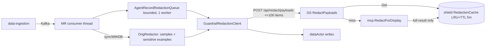

# Display redaction of stored payloads in mini-runtime

Status: built and unit-tested in all three repos (shield, guardrails-service, mini-runtime). Not yet
run end to end against a live guardrails-service. Nothing is committed or pushed.

## Purpose

mini-runtime (MR) stores raw traffic payloads as sample data, sensitive sample data and agent query
records. They are shown for observability, so they should hold one complete, final redaction of the
data, **independent of any guardrail policy**. MR asks guardrails-service (GS) over HTTP; GS masks each
payload the way threat events already do and keeps a bounded 5-minute cache.

An earlier draft redacted with the account's guardrail policies. That was dropped: policy-driven
masking depends on context source, device, user and policy version, none of which MR has, and it is
not what an observability view needs. Nothing policy-related is sent or used now.

Off by default. Enabled only with `AKTO_GUARDRAIL_REDACTION_ENABLED=true` and
`AKTO_GUARDRAIL_REDACTION_URL` (no default URL). With it off every call site behaves exactly as before.

## What does the masking

`mcp.RedactForDisplay` (shield, `mcp/display_redaction.go`) is `anonymizeEscapedText`, the call
`ReportThreat` makes for the payload fields of a threat event: the Presidio-backed Anonymize scanner
(worker-py `/scan`), then a deterministic scrub of secret types and gitleaks findings. If the scanner
does not answer, the full regex PII set plus gitleaks is applied instead, so raw text is never
returned; the result is then flagged `Basic`.

## Where it lives

| Repo | What |
|---|---|
| `akto-gateway/mcp-endpoint-shield/mcp` | `display_redaction.go` (`RedactForDisplay`), `redaction_cache.go` (bounded TTL cache), `anonymizeTextChecked` / `anonymizeEscapedTextChecked` (the existing functions, now also reporting whether the scanner answered) |
| `akto-mini-services/.../guardrails-service/container/src` | `POST /api/redact/payloads` (`handlers/redaction.go`), `pkg/validator/redact.go` (`RedactPayloads`), `models/redaction.go`, config in `pkg/config/config.go` |
| `akto/apps/mini-runtime/.../hybrid_runtime/redaction` | `GuardrailRedactionClient`, `OrigRedactor` (samples), `AgentRecordRedactionQueue`, `PayloadRedaction` (entry point), `RedactionConfig` |
| `akto/libs/utils` | `AgentQueryRecord.withPayloads(...)` and a nullable `payloadRedaction` field |

Call sites in MR: `Main.captureRedTeamingAgentQueryRecords` and `HttpCallParser.captureAgentTrace`
(agent records), `APICatalogSync.handleSampleDataRedaction` + `processSampleBatch` (samples),
`APICatalogSync.getDBUpdatesForParamsHybrid` (sensitive examples). Redaction runs at write time,
after sensitive-data detection already ran on the raw payload, so it cannot affect detection.

## Data flow

Calls go one way, MR -> GS, so there is no cycle. Cache Get/Put are O(1) under the LRU's own mutex and
never hold a lock across I/O; two concurrent misses may both redact and the last Put wins, with equal
results.

The cache dedupes repeats on MR's side (the same payload as a sample, a sensitive example and an agent
record, or an identical payload seen again within 5 minutes). **It is not shared with
`/api/validate/request`**: that path does not produce a full redaction of the raw payload (it applies
policy rules), so there is nothing for it to fill or read.

## Result statuses (per payload side)

| Status | Meaning | MR stores |
|---|---|---|
| `REDACTED` | masked in full, payload changed | masked payload |
| `UNCHANGED` | masked in full, nothing to mask | raw payload |
| `REDACTED_BASIC` | scanner did not answer; regex + secret scrub only | masked payload + marker `BASIC` |
| `UNAVAILABLE` | oversize, deadline, error, GS down, breaker open | raw payload + marker `UNAVAILABLE` |

Markers: agent records get `payloadRedaction` (`BASIC` or `UNAVAILABLE`); samples and sensitive
examples get `"aktoPayloadRedaction"` added **after** `RedactSampleData` runs, because that step
rebuilds the message from fixed keys and would drop it. When the two sides differ the worse marker wins.
A record with no marker is fully redacted or had nothing to mask.

nil / empty / absent: an empty or missing payload is never sent and has no result (not "unchanged").
The Go DTOs omit an unsent side; the Java client treats a missing side for a sent payload as
UNAVAILABLE, and an unknown status string (including the old `NO_POLICIES`) parses to UNAVAILABLE.

## Cache

Key: `sha256(method | host | path | payload)`, method upper-cased, host lower-cased, fields
length-prefixed (`RedactionCacheKey`). Method, host and path only identify the endpoint; they never
change the masking. Only `REDACTED` and `UNCHANGED` are cached, so an outage cannot pin the weaker
`BASIC` result for the TTL. Bounded by `max entries x max payload bytes` (about 256 MB worst case).
Accepted: identical text sent as a request and as a response of the same endpoint shares an entry
(harmless now that masking does not depend on the side).

## Failure semantics

- Transport failure, timeout, open breaker (5 consecutive failures, 30 s), malformed answer, missing
  item or side, a redacted status without a payload: every affected side is UNAVAILABLE. No retries;
  the next occurrence tries again.
- Agent records are never dropped by default: queue full, service failure or anything unexpected stores
  the raw record with the marker, and a record reaches the sink at most once (`Pending.delivered`).
- `AKTO_GUARDRAIL_REDACTION_SKIP_ON_UNAVAILABLE=true` changes that for **UNAVAILABLE only**: the
  payload is not stored at all (agent record not handed to the sink; sample or sensitive example left
  out of the write; an endpoint whose samples were all skipped gets no write). Skips are counted and
  logged per batch/sync (agent: first and every 100th). BASIC (regex scrub applied) and fully redacted
  results are always stored. Default false keeps the store-and-mark behaviour. A skipped sample is
  lost until the endpoint is seen again; a skipped agent record is not retried.
- Timeouts nest: GS `GUARDRAILS_REDACT_TIMEOUT_MS` 6000 < MR call 8000. The sample/example pre-pass runs
  **outside** the 10 s `runWithTimeout` batch window with its own budget (default 20 s per sync);
  items after the budget are UNAVAILABLE.
- Full redaction (account or collection level `redact`) already masks every value, so the pre-pass is
  skipped there. The encrypted raw copy kept for Postgres is intentionally unchanged.

## Decision log (status as of the review)

| Decision | Choice and why | Evidence | Status |
|---|---|---|---|
| Redaction independent of policy | Observability needs one complete masking; policy scoping needs context MR does not have | `display_redaction.go:24`; request model has no policy field (`models/redaction.go`) | verified |
| Reuse the threat-event masking | Same `anonymizeEscapedText` chain as `ReportThreat`, so stored data matches what events show | `evidence_line.go:64`, `anonymize_client.go:42`; scanner-down and escape round-trip tests in `display_redaction_test.go` | verified |
| Redact at write time in MR | Sensitive-data detection already ran on the raw payload | `APICatalogSync.java:149-205` (detection) before `:1736`, `:1774`, `:1844` (redaction) | verified |
| Agent records via bounded async queue | Consumer thread is single and must not wait on GS | `AgentRecordRedactionQueue.java:58-66`; MR unit tests removed, only the opt-in E2E IT covers the queue | **unverified** by unit test |
| Cache in the shield, keyed by endpoint + payload | Result depends on the payload alone; key excludes account/side/policy by decision | `redaction_cache.go:54`; `redact_test.go` cache and same-result tests | verified |
| Only full results are cached | A reduced-strength or failed result must not be pinned for the TTL | `redact.go:116-120`; basic and unavailable tests; live check (two misses, no hits) | verified |
| Failure = persist as is + marker | No data loss, nothing that failed reads as redacted | `OrigRedactor.java` markers; E2E IT with the service unreachable (MR unit tests removed) | verified by E2E IT only |
| Pre-pass outside the 10 s batch timeout | Redaction has its own budget | `APICatalogSync.java:1736` is before `runWithTimeout` | verified by reading; no test drives `handleSampleDataRedaction` |
| Skip instead of store when UNAVAILABLE (flag, default off) | Lets an install prefer no data over unredacted data; BASIC still stored because it is masked | `RedactionConfig.skipWhenUnavailable`, `OrigRedactor.Result.skip`, `AgentRecordRedactionQueue.deliver` | **unverified**: the MR unit tests (including the skip tests) were removed with `FakeTransport` |
| Scanner capacity (8 concurrent, 6 s per call) | Bounded work; excess becomes UNAVAILABLE | `redact.go:45`, `:89` | **unverified**: never measured against the real Anonymize scanner |
| Cyborg accepts `payloadRedaction` on agent records | Field is omitted when null, so old records are unchanged | `AgentQueryRecordWithPayloadsTest` (JSON) | **unverified** against cyborg |

## Config

MR: `AKTO_GUARDRAIL_REDACTION_ENABLED`, `_URL`, `_CONNECT_TIMEOUT_MS` 1000, `_CALL_TIMEOUT_MS` 8000,
`_BUDGET_MS` 20000, `_CHUNK_SIZE` 100, `_MAX_PAYLOAD_BYTES` 262144, `_BREAKER_THRESHOLD` 5,
`_BREAKER_OPEN_MS` 30000, `_QUEUE_CAPACITY` 5000, `_LINGER_MS` 200,
`_SKIP_ON_UNAVAILABLE` false (true: do not store payloads that could not be redacted). Auth header is
`DATABASE_ABSTRACTOR_SERVICE_TOKEN`, as the SaaS guardrail forwarder does.

GS: `GUARDRAILS_REDACTION_CACHE_MAX_ENTRIES` 4096 (0 disables), `_TTL_SEC` 300,
`_MAX_PAYLOAD_BYTES` 65536, `GUARDRAILS_REDACT_TIMEOUT_MS` 6000, `_CONCURRENCY` 8, `_MAX_ITEMS` 100,
`_MAX_PAYLOAD_BYTES` 262144.

## Gotchas

- Capacity: each side is one Anonymize scanner call (5 s timeout inside `anonymizeText`), items run 8
  at a time, and a call has 6 s. A slow scanner therefore turns a large batch into `UNAVAILABLE` items
  rather than slow ones; raise `GUARDRAILS_REDACT_CONCURRENCY` if the scanner can take it. Items not
  started before the deadline are `UNAVAILABLE`, never masked under an expired context.
- Samples are the raw `orig` JSON; only `requestPayload` and `responsePayload` are rewritten, other
  fields (including headers) are untouched. Headers are not redacted by this feature.
- `AgentQueryRecord` payload fields are final; use `withPayloads`. Token counts stay computed from the
  raw payloads. The record's query payload is the raw request payload (`AgentQueryRecord.java:296`);
  the response payload has `awsMetadata`/`alibabaMetadata` stripped.
- Kafka-mode GS (`KAFKA_ENABLED=true`) has no HTTP routes: every item is UNAVAILABLE.
- GS compiles against the shield through a `go.mod` `replace` to a published pseudo-version. The new
  symbols exist only in the local shield branch, so **GS cannot build from its own go.mod until the
  shield is pushed and `go.mod:134` is bumped**. This work was built with a scratch `go.work`.
- The shield change to `anonymizeText` / `anonymizeEscapedText` only adds `...Checked` variants that
  also return whether the scanner answered; the original functions delegate to them unchanged.
- Logs never carry payloads: exception messages from Jackson and Gson quote the text they choked on, so
  the MR code logs the exception type only (and the message only for transport `IOException`s).
- A message that cannot be read, or whose redacted form cannot be written, is stored as it is with the
  `UNAVAILABLE` marker; it is never treated as clean.
- `OrigRedactor`'s memo lives for one sync and holds the sample strings of that sync. It is released at
  the end of `syncWithDB`; if a sync throws first it is released when the next sync starts.
- The endpoint is as open as `/api/validate/*`: `AKTO_GR_AUTHENTICATE` defaults to false. One call can
  carry 100 items of 256 KB (the body cap is about 52 MB) and each side costs a scanner call, so an
  unauthenticated deployment can be made to do a lot of work. Turn authentication on, or lower
  `GUARDRAILS_REDACT_MAX_ITEMS` / `_MAX_PAYLOAD_BYTES`, where the service is reachable by anything
  other than mini-runtime.
- `GuardrailRedactionE2EIT` drives the real client, sample redactor and queue over HTTP. It is skipped
  unless `AKTO_GUARDRAIL_REDACTION_E2E_URL` points at a running guardrails-service whose Anonymize
  scanner masks "Jane Doe". It was run once against a harness (real GS handler, service and shield; fake
  scanner) with all four cases passing.
- Some shield tests read the developer's `~/.claude/plugins` (`plugin_scanner`) and fail on a machine
  with plugins installed; unrelated to this feature (passes with a clean `HOME`).

## Open work

- Unverified: that cyborg accepts the new `payloadRedaction` field on agent records; the real latency
  and cost of the Anonymize scanner at MR's volume (it is one remote call per payload side).
- Headers are not redacted. Traces/spans, MCP audit logs, central Kafka (`getOrig`) and protobuf Kafka
  sinks are not covered.
- Whether `/api/validate/request`'s threat-report path should read this cache: `ReportThreat`
  anonymizes the same payload strings per field, but after policy masking, so the inputs differ.
- GS Kafka-mode support; metrics beyond logs (`RedactPayloads - completed` line, queue `stats()`).
